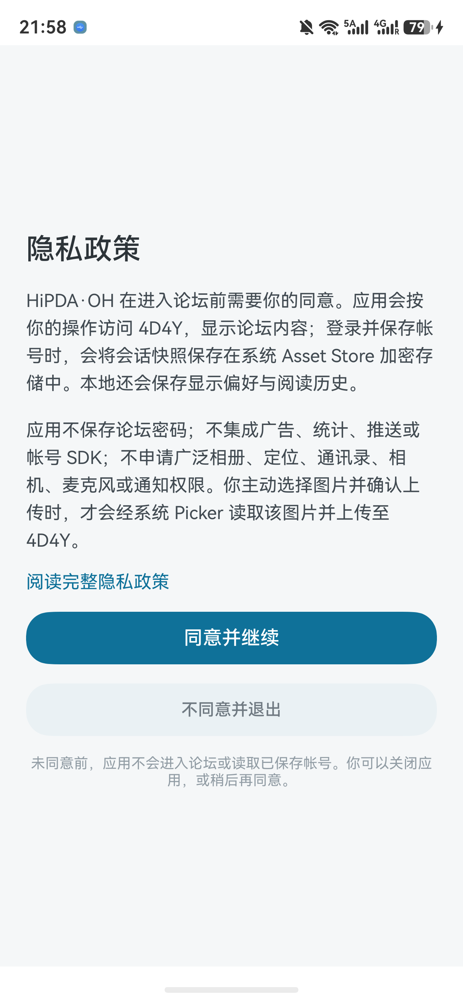

# 首次安装教程

[返回首页](../README.md) · [日常升级](UPDATE.md) · [续期与迁移](RENEWAL.md)

HiPDA·OH 目前未上架应用商店，通过 [GitHub Releases](https://github.com/sis5595/hipda-oh/releases) 提供未签名 HAP。面向原生 HarmonyOS 6.1.1 及以上设备，不适用于 Android。

**安装工具正在重新验证，目前没有默认推荐工具。项目已停止推荐小白调试助手，也尚未验收 HoKit、QSStore 等替代方案。** 本页先说明已确定的下载方式；新工具的完整安装步骤会在实测后补充。

## 1. 下载正确的文件

1. 在电脑或手机浏览器打开[官方下载页面](https://github.com/sis5595/hipda-oh/releases)。
2. 选择需要的版本，展开 **Assets**。
3. 点击 `hipda-oh-版本号-unsigned.hap`，不要选 `Source code` 源码压缩包。
4. 同时下载 `SHA256SUMS.txt`，保留官方公布的文件校验信息。

成功标志：下载目录中有完整的 `.hap` 文件。**浏览器下载完成不等于已经安装，也不等于已完成 SHA-256 校验。** 不使用来源不明的镜像或他人提供的通用签名包。

GitHub 打不开或文件下载中断：请稍后重试，或用自己的其他网络、电脑浏览器访问同一官方下载页面。不需要向 HiPDA·OH 提供 GitHub 密码或 Token。

## 2. 等待经项目验证的安装方案

这里的“签名”是给安装包加上允许在你的设备运行的凭证。未签名 HAP 不能通过点击文件直接安装。

所选工具可能要求你自己的华为开发者账号、开发者认证、手机开发者模式和设备调试授权。具体操作与条件取决于工具，不要把账号密码、验证码或签名凭证交给群友或项目维护者。

普通用户无需安装 DevEco Studio，也无需执行命令行。由于替代工具尚未验收，本项目目前不提供未经验证的按钮位置或签装教程；不熟悉侧载的用户建议等待教程更新。

已熟悉侧载的用户如自行选择工具，应核对：

- 支持原生 HarmonyOS NEXT，而非只支持 Android APK。
- 识别出的包名为 `com.sis5595.hipdaoh`，版本与下载页一致。
- 手机及签名账号属于自己，工具来源可追溯。
- 签名、安装和后续续期的条件清楚，不能把一次安装成功当作长期免续期。

## 3. 安装后检查

1. 从手机桌面打开 **HiPDA·OH**，阅读隐私说明并自行选择是否同意。
2. 进入 **设置 → 关于 HiPDA·OH**，核对安装版本。
3. 使用自己的论坛账号登录。首次安装没有之前的本地会话和阅读记录是正常情况。

以下为真实隐私页面截图；政策更新时日期可能变化。

若你已有旧版，请先看[日常升级](UPDATE.md)，不要按首次安装直接卸载。如果原来使用小白，请看[迁移提醒](RENEWAL.md#原小白用户迁移提醒)。

## 验证范围

官方 HAP 下载、客户端 SHA-256 校验和系统文件分享已有真机记录。替代安装工具的首次签装、覆盖升级、续期及数据保留尚未验收；不能把下载文件或看到分享面板视为完成安装。
