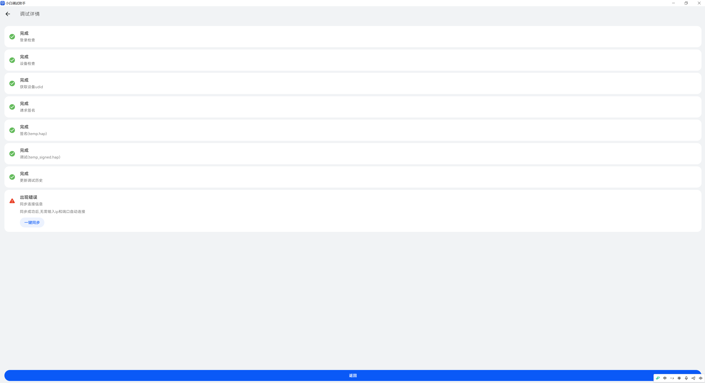
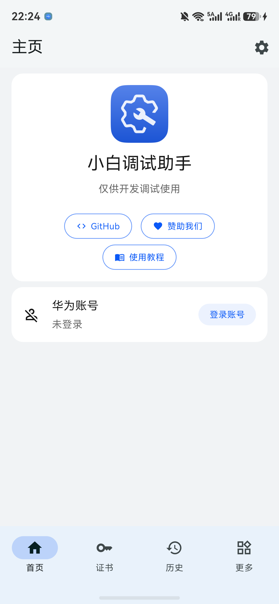

# 首次安装教程

[返回首页](../README.md) · [日常升级](UPDATE.md) · [续期与常见问题](RENEWAL.md)

适合 Windows 10/11 电脑和原生 HarmonyOS 6.1.1 及以上手机。**不用安装 DevEco Studio，不用输入命令。**

目前 HiPDA·OH 不在应用商店，需要用自己的华为开发者账号，通过小白调试助手安装。这里的“签名”可以理解为给安装包加上允许在你手机上运行的凭证；不是让你编写程序，也不要把密码或凭证交给别人。

验证范围：维护者曾用小白 2.4.0 成功侧载本项目。本轮已用 Windows 小白 3.1 将小白手机版安装到 Mate 60，完成登录和连接；随后通过手机小白“直接安装”将原签名 HiPDA·OH 从 beta.5 升到 beta.6 候选版，核对了账号、设置和可见浏览记录保留。**全新华为账号注册、手机小白为本项目自动重签和续期尚未完整验收。**

## 1. 准备文件

在电脑浏览器依次打开：

1. [HiPDA·OH 下载页](https://github.com/sis5595/hipda-oh/releases)。找到要安装的版本，展开 **Assets**，点击以 `-unsigned.hap` 结尾的附件。不要选 `Source code`。成功后电脑“下载”文件夹里应有 `.hap` 文件。
2. [小白助手 3.1 官方下载页](https://github.com/likuai2010/auto-installer/releases/tag/3.1.0)。同样在 **Assets** 下载 `hap_installer-Windows-3.1.0.zip` 和 `hap_installer-harmonyos-3.1.0.hap`。前者给电脑用，后者留给手机用；不要下载 Android 的 APK。
3. 在 Windows 文件资源管理器中，右键 Windows ZIP → **全部解压缩**，解压到容易找到的文件夹。不要只把 EXE 拖出来，保留里面的配套文件。

失败怎么办：网页打不开或文件下载不完整，请看[GitHub 下载失败](RENEWAL.md#github-打不开或下载中断)。不要用陌生人发来的“已签名通用包”代替。

## 2. 准备华为账号

1. 浏览器打开[华为开发者联盟的开发者信息页](https://developer.huawei.com/consumer/cn/console/setting/account)。未登录时，自己完成华为账号登录；没有账号则在华为登录页选择注册。
2. 按网站当前提示完成个人开发者注册和实名认证。账号须为自己的账号；证件、银行卡或验证码只在华为官方页面按需填写，不发给维护者或群友。
3. 成功标志：网站显示已完成开发者认证，且小白随后可以完成账号授权。

页面可能因地区和账号状态不同而变化；无法认证时先按华为提示处理，不要购买共享账号。签名证书和应用运行授权可能各有有效期，以工具显示的**本应用到期日**为准，不要把“一年”或“180 天”当成所有设备的固定承诺。

## 3. 让电脑能连接手机

准备能传数据的 USB 线，手机解锁。以下操作只在自己的电脑上进行。

1. 手机打开 **设置 → 关于本机**（部分版本显示设备名称或“关于手机”），找到 **软件版本**，连续点击，按系统提示开启开发者模式；如需锁屏密码，请自己输入。
2. 返回设置，在 **系统 → 开发者选项** 中开启 **USB 调试**，用数据线连接电脑。
3. 手机如弹出是否允许这台电脑调试，核对是自己的电脑后确认。不要授权陌生电脑。
4. 打开解压后的电脑端小白助手。在设备区域确认识别出你的手机。**成功标志是设备已连接，而不只是手机在充电。**

找不到上述菜单：在手机设置搜索“开发者选项”“USB 调试”；受组织管理的手机可能不允许开启，不能靠本教程绕过。

如果 USB 无法连接，可按小白的 **连接设备** 入口改用无线：电脑和手机在同一可信 Wi-Fi，手机开发者选项内打开 **无线调试**，把当前显示的 IP 和端口填入小白。端口可能变化，不要照抄别人截图中的数字。失败先重新核对手机当前地址。

## 4. 登录小白，安装 HiPDA·OH

1. 在小白首页点击 **登录账号**。在打开的华为官方网页完成登录和授权，然后回小白。成功标志是首页账号区域变为已登录，不再要求登录。
2. 在软件安装包区域点击 **选择**，选刚才下载的 HiPDA·OH `.hap`。
3. 确认包名是 **`com.sis5595.hipdaoh`**、设备是自己的手机，再点击 **开始调试**。它负责签名、绑定设备和安装，不是让你调试代码。
4. 等待工具明确报告安装成功，再到手机桌面打开 **HiPDA·OH**。能打开应用并读到隐私说明，才算首次安装完成。

出现任何失败：先保存错误文字，查[常见问题](RENEWAL.md)，不要连续点重置证书。按钮不同或菜单找不到时，先用工具首页的 **使用教程**，不要按截图位置盲点。

下面是 Mate 60 上实际显示的隐私说明。请自行阅读后决定是否同意；选择“不同意并退出”不会进入论坛。新版政策变更时，也可能再次出现此页面，不表示原有数据已被清空。

### 真实界面参考

下面是 [Kazumi 社区安装文档](https://kazumi.app/docs/misc/how-to-install-in-ohos/)中的小白真实界面，**是 macOS 的旧版示例，不是本次 Windows 3.1 实测截图**。用来认识“连接设备”“选择”“开始调试”所在区域；图中包名是 Kazumi，你应核对为 `com.sis5595.hipdaoh`。不复制示例的账号或地址。

Windows 3.1 的本机实测截图尚待补齐；本文不使用模拟截图冒充实测。

## 5. 把小白助手也装到手机

1. 保持电脑端小白已登录、手机已连接。
2. 再点 **选择**，这次选 `hap_installer-harmonyos-3.1.0.hap`，核对选中的是小白助手，然后 **开始调试**。
3. 安装成功后在手机打开小白。根据它的教程完成华为账号登录和设备连接，先确认能显示自己的手机。

下图是本轮 Windows 3.1 安装小白手机版后的实际结果：请求签名、签名、调试安装均为“完成”。截图时底部“同步连接信息”仍报错，后续按下方步骤同步成功；无需因此重复安装。

手机首次打开可能询问日历权限，用于到期提醒，请自行决定是否允许。关闭“无线调试”设置弹层后可看到以下首页；点击 **登录账号** 完成手机端登录。电脑端已登录，不等于手机端也已登录。

本轮实测的连接步骤：

1. 手机小白完成登录后，保持其打开，USB 仍连接电脑。
2. 回电脑小白的安装结果页，在 **同步连接信息** 下点击 **一键同步**。本次电脑提示文件传输完成。
3. 手机出现是否信任此设备的询问时，核对是你自己的电脑后，由你决定是否选择 **始终信任**。
4. 返回手机小白的无线调试连接界面，确认连接。成功标志是显示 **连接成功**，本次连接地址为本机 `127.0.0.1:12345`；不要把这个地址当成需要所有用户手动填写的固定配置。

如果未成功，不要反复重装或重置证书；先检查手机是否解锁、信任提示是否处理、手机小白是否保持打开，再重试同步。自动签名和证书续期仍需与“直接安装已签名包”分别核对。

这是首次引导安装，不是下载 HAP 后直接点击安装。上游特别说明：升级到 3.1 需使用 2.5 或更高版本助手，不要用 2.4 给助手自身升级。

3.1 宣布支持保存登录状态，且会在“下载/小白调试助手”保存账号及备份文件。**不要清理或公开这些文件，不要上传网盘分享给别人。** 登录仍可能过期，需要你重新授权；不保证永不登录。

如果手机助手无法完成登录或连接，可继续用电脑更新 HiPDA·OH，不必为了启用手机更新卸载已有应用。已经验证的手机覆盖路径使用原签名 HAP；本轮小白保存安装历史及自身续期仍出现错误，详见[续期与常见问题](RENEWAL.md)。

下一步：[日常升级教程](UPDATE.md)。
