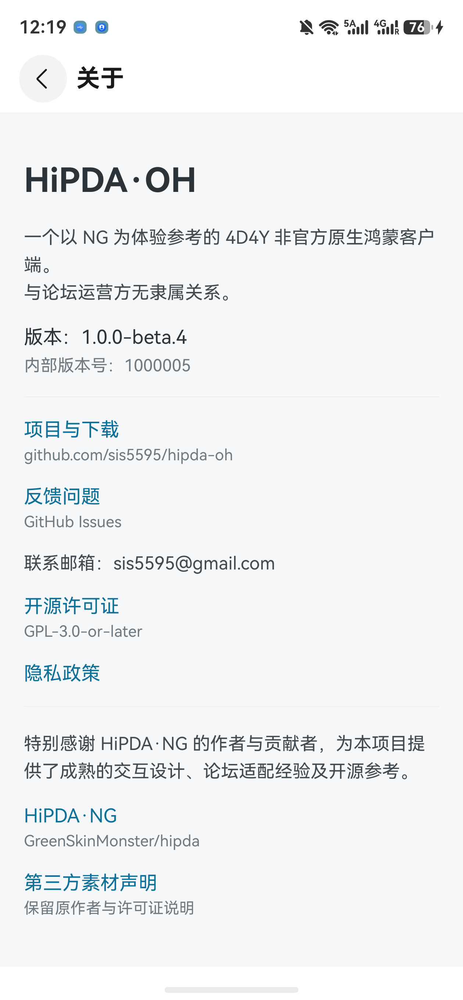

# 日常升级教程

[返回首页](../README.md) · [首次安装](INSTALL.md) · [续期与常见问题](RENEWAL.md)

**不要先卸载旧版。** 尽量使用首次安装时的小白助手、华为账号和原签名材料；仅账号相同并不保证签名相同。若工具提示“签名不一致”，停止安装，按[恢复说明](RENEWAL.md#签名不一致或证书失效怎么办)处理。

## 先看你装的是哪个版本

打开 HiPDA·OH 左上角抽屉，点 **设置**，向下滑到 **关于 HiPDA·OH**，记下版本和内部版本号。

下面是 Mate 60 的实际截图（2026-10-21，安装的是 beta.4），用于确认版本位置；不是新版更新功能截图。

已公开的 beta.5 没有应用内更新按钮，请使用下面的“电脑升级”。本开发分支新增的“检查更新 / 下载 / 分享”流程**尚待真机验收，不能把它当作 beta.5 已有功能**；发布带此功能的新版本后才会看到这些按钮。

## 在手机中检查和下载（带更新功能的版本）

1. 在 **关于 → 应用更新** 点击 **检查更新**。
   - 出现“当前已是最新版本（包含 Beta 版）”：不用继续。
   - 出现“发现新版本”：下方显示版本和更新内容。
   - 提示连接失败或访问次数受限：稍后重试，或点 **打开 GitHub 下载网页**。不要反复快速点击。
2. 看完更新内容，点击 **下载 / 重新下载 HAP**。保持此页面打开，进度条显示下载百分比。
3. 下载到 100% 后，还要等待 **SHA-256 校验通过**。这是检查文件是否完整一致，不是安装已经完成。
   - 校验失败：没有可用分享入口，点击重新下载；重复失败请反馈。
   - 想停止：点 **取消下载**，以后可重新下载；离开页面也会取消未完成的操作。
4. 点击 **分享已校验的安装包**，应用会再次校验，再弹出鸿蒙系统分享面板。
5. **只有面板确实出现兼容的安装工具时**才选择它。核对包名 `com.sis5595.hipdaoh` 和新版版本号，按工具提示用原签名覆盖安装。

这里是“系统文件分享”，不是已验证的一键安装。HiPDA·OH 不替你登录华为、不签名，也不能从分享结果判断安装成功。**小白 3.1/HoKit 是否出现在当前系统分享面板、能否接收此 HAP，仍待实机验证。**

### 分享面板没有安装工具

不用反复点分享：

1. 点 **打开 GitHub 下载网页**，在新版的 **Assets** 下载 `-unsigned.hap`。
2. 如果手机小白的 **选择** 可以选到浏览器下载的 HAP，可在小白内选包；核对原签名后安装。
3. 若手机内选包、登录或连接不成功，用下面的电脑流程。不要安装陌生的“万能安装器”。

新版 HiPDA·OH 更新页面和系统分享面板的真实截图待手机验收时补齐。不会用绘制图片代替实际界面。

## 电脑升级（beta.5 也适用）

1. 电脑打开[官方 Releases](https://github.com/sis5595/hipda-oh/releases)，选择要升级的版本，读更新内容，展开 **Assets**，下载 `-unsigned.hap`，不要选源码 ZIP。
2. 打开**原来使用的小白助手**，确认华为账号和签名材料没有更换。
3. 连接手机；设备栏应显示你的手机已连接。
4. 点击 **选择**，选新版 HAP。确认包名与旧版相同，再点 **开始调试**。
5. 等工具报告安装成功，重新打开 HiPDA·OH。若工具要求卸载旧版或提示签名冲突，先停止。

“选择”和“开始调试”的[社区真实界面参考](INSTALL.md#真实界面参考)可帮助找到入口，当前 Windows 3.1 完整覆盖升级还未实测。

## 手机下载后交给小白（文件选取已实测）

本轮 Mate 60 + 小白 3.1 的系统分享列表没有出现小白，不能承诺一键交接。可使用以下备用步骤：

1. 在更新页面下载，等到显示 **SHA-256 校验通过**；校验未通过时不要继续。
2. 点击 **分享已校验的安装包**，在系统分享面板点 **另存为**。
3. 选择 **Download** 文件夹，保持 `.hap` 后缀，点击右上角对勾。不要覆盖其他用途的文件。
4. 打开手机小白，点击“软件安装包”旁的 **选择**。
5. 进入 **我的手机 → Download**，选中刚保存的 `hipda-oh-版本号-unsigned.hap`，点击 **完成**。
6. 回到小白，核对识别出的应用名、目标版本及包名 `com.sis5595.hipdaoh`。

以上六步已实测成功。下一步 **开始调试（自动签名）** 只可在确认沿用原签名后执行；本轮未执行，不代表小白覆盖升级和数据保留已经验收。原来用 DevEco 签装的应用尤其不能假定与小白签名相同。

## 每次升级后都做这四项检查

1. **关于**：版本和内部版本号变为目标版本。
2. **账号管理**：原来的账号仍在；打开原来可访问的版面。论坛会话自然过期导致重新登录，不一定是数据被删除。
3. **设置**：检查主题、字号及自己修改过的一项偏好。
4. **浏览记录**：找升级前刚读的主题，确认还在并可打开。

升级前可以把这些信息记在自己手机备忘录中，不要公开账号、私信、Cookie 或调试日志。仅能打开新版，不能证明数据全部保留。

## 已验证与未验证

- 维护者已确认旧版 HAP 可用小白 2.4.0 侧载。
- 新更新代码的版本比较、下载进度、损坏阻断等可离线测试，不等于真实系统交接成功。
- 开发版已在 Mate 60 实测“检查更新”：网络可达时能正确识别当前已是最新 Beta；无法连接时显示提示并允许重试。手机能浏览论坛不代表同一网络一定能访问 GitHub。
- **3.1 同签名覆盖、原账号/设置/阅读记录保留、续期后保留：尚待真实手机验收。**
- 换安装工具不等于能继续使用原签名，不能把 HoKit 当成保证无损的自动替代品。
